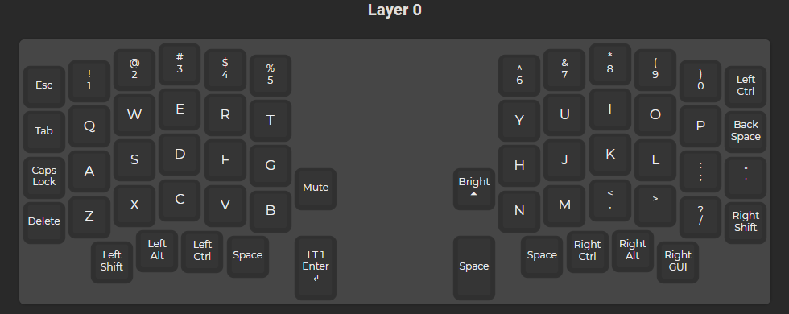
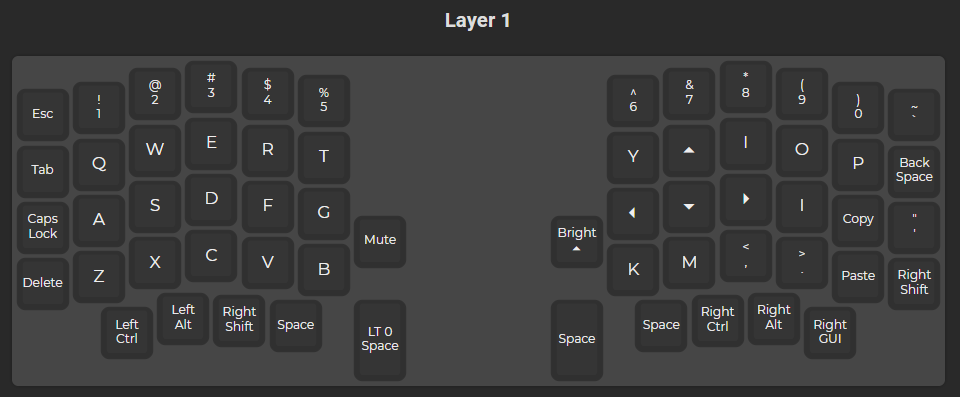

# Sofle/rev1

This is the repo that stores the keymaps for my split `sofle/rev1` that I made, with the help of my friend. Check the below keymap images for the different version of the keymaps *(the latest version is the one that is present on my keyboard)*.

## KEYMAPS
### `v1.0`

## HOW TO FLASH NEW KEYMAPS
This is very essential- how to load the new keymaps to the sofle.
> [TIP]
> Gemini or GPT how to **compile** the `.json` file that you made on **QMK Configurator** online web-app

1. Ensure, both the keyboards are **NOT CONNECTED** to each other; and even, none of them is **CONNECTED TO LAPTOP**.
2. Make your own custom keymap on [QMK Configurator](https://config.qmk.fm/#/sofle/rev1/LAYOUT)
3. Once new keymap made, head on to download the **QMK Toolbox** and **QMK Mysys**. Check them out [here](https://qmk.fm/toolbox)
4. Setup the QMK Mysys on your laptop- to see how to do that, either GPT it, or check here- [link#1](https://youtu.be/z4gDNtQnBYg?si=HAUOF_5rruXUrviC) | [link#2](https://youtu.be/fuBJbdCFF0Q?si=3ZEfsf761t87SAJM)
5. Once setup, then, connect the **LEFT-HALF** of the keyboard to computer using the Type-C connector.
6. Flash the `.json` to the Keyboard's left side first.
7. Once left done, disconnect that, conect the right, and then, flash the right one.

## KEYCAPS LINK
Well, if you liked the current setup that I have *(as uploaded and seen in the above image)* - here is the current keycap theme, and its link to buy:-
- **THEME**:- Evangelion
- **LINK**:- 
- **KEYCAP COST**:- ~1600INR

